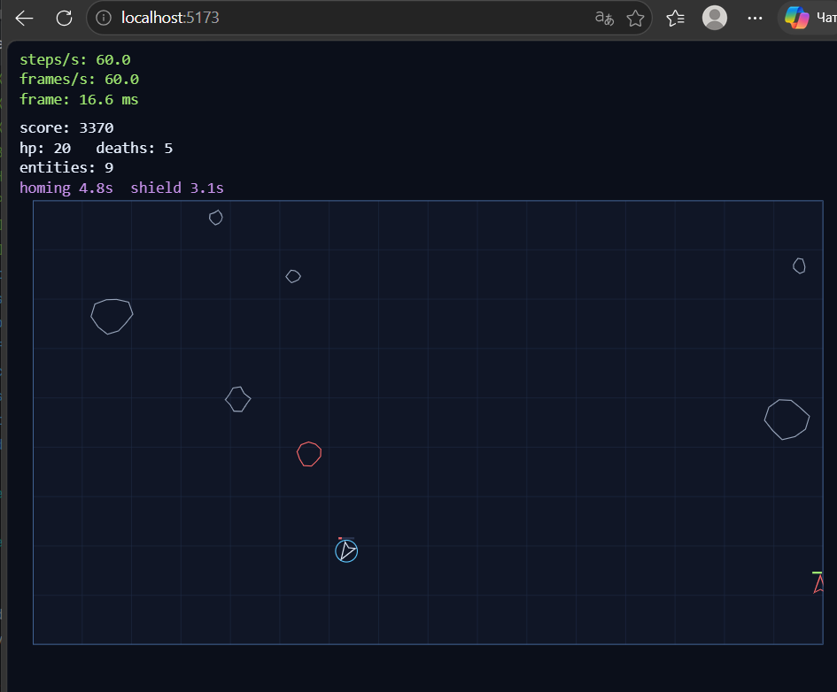
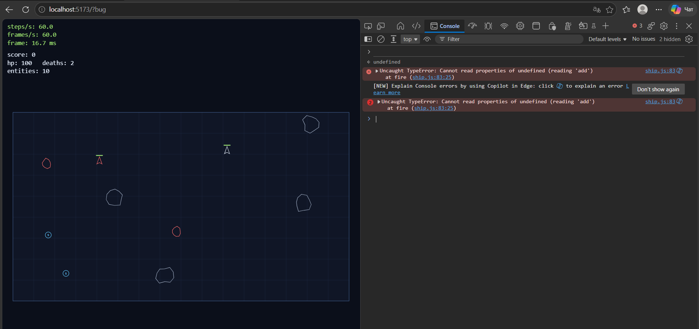

# Dogfight

Браузерна гра: космічний корабель на арені з «загортанням» країв, астероїди, кулі, pickup-и.
Курс JavaScript, лаби 1–2 (мультиплеєр з'явиться в Lab 5).

**Керування:** ←/→ або A/D поворот, ↑ або W тяга, **Space** стрільба (утримувати), **клік мишею** один постріл.
**Pickup-и:** **S** щит (6 с без шкоди), **R** швидкострільність (8 с), **H** самонавідні кулі (8 с).
Червоний корабель — навчальний дрон-мішень. Червоні астероїди — «мисливці», що летять на кораблі.

## Як запустити

```bash
npm install
npm run dev     # гра: http://localhost:5173
npm test        # тести симуляції (Node, без браузера)
npm run lint    # Biome
```

Версія Node вказана в `.nvmrc`.

## Структура

```
src/
  main.js              збирає все разом, запускає цикл; фікс this для кліку
  loop.js              фіксований крок 1/60 с (Lab 1)
  input.js             клавіатура як замикання (Lab 1)
  render/canvas.js     canvas з урахуванням devicePixelRatio
  render/draw.js       малювання за kind + інтерполяція + HUD
  sim/                 симуляція без DOM (працює і в Node)
    vector.js          Vector2 — незмінний, усі методи повертають новий вектор
    entity.js          базовий Entity: static #nextId, get id, pos, vel, radius, kind, update
    ship.js            Ship extends Entity: #hp, get hp, fire(), takeDamage, респаун
    bullet.js          Bullet extends Entity: TTL, власник, компонент homing
    asteroid.js        Asteroid extends Entity: hp, розколювання, компонент homing
    pickup.js          Pickup extends Entity: стоїть, компонент pickup
    explosion.js       Explosion extends Entity: частинки
    components.js      компоненти-дані: homing, pickup, effects
    world.js           World: Map<id, Entity>, spawn/despawn, ітератор, *ofKind, step
    collision.js       коло-коло O(n²), генерує пари [a, b]
    rules.js           що робити з парою: шкода, pickup, відскок
    systems.js         homing-система
    spawner.js         поява астероїдів і pickup-ів
    random.js          детермінований генератор (seed)
    game.js            стартовий світ
test/sim.test.js       13 тестів симуляції
```

## Лаба 2: об'єкти, класи, this і композиція

### Що зроблено

- **Vector2** з чистими методами `add`, `sub`, `scale`, `length`, `normalize`, `rotate`, `dot`, `static fromAngle`.
  Вектори не мутуються, тому для інтерполяції достатньо зберегти посилання: `prevPos = pos`.
- **Entity**: приватний статичний лічильник `static #nextId` і `#id` з публічним `get id()`.
  Наслідування рівно на **один рівень**: `Ship`, `Bullet`, `Asteroid`, `Pickup`, `Explosion` extends `Entity`.
- **World** зберігає сутності в `Map<id, Entity>`:
  - `spawn` під час кроку кладе сутність у чергу й додає після кроку;
  - `despawn` лише ставить `alive = false`, а видаляє `#sweep` наприкінці `step`;
  - `[Symbol.iterator]` дає `for (const e of world)`, генератор `*ofKind(kind)` фільтрує без проміжного масиву.
- **World.step(dt, inputs)**: зберегти попередній стан → системи (spawner, homing) → `update` усіх → пари колізій → правила → `#sweep`.
- **Колізії** — окрема функція-генератор `circleCollisions(world)`, яку передано в `World` параметром `detect`.
  Її можна замінити на spatial hash, не чіпаючи правил. Відстань рахується з урахуванням загортання країв.
- **Корабель**:
  - приватне `#hp` і `get hp()` (присвоєння `ship.hp = 1000` кидає `TypeError`);
  - приватний метод `#explode`;
  - вибух із частинок і респаун через 2 с у безпечній точці з 1.5 с невразливості;
  - очки на HUD: астероїди 20/50/100, дрон 100.
- **Кулі** вилітають з носа корабля з успадкованою швидкістю, живуть 1.1 с.
- **Астероїди** дрейфують, відскакують один від одного, великі розколюються на два менші.
- **Детермінізм**: замість `Math.random` у симуляції — генератор із seed. Тест перевіряє, що два запуски по 20 с дають однаковий світ (знадобиться в Lab 5).



### Баг з this у колбеку та його фікс

`fire()` — звичайний метод класу, тому його `this` визначається **в момент виклику**, а не тим, «чий це метод».

Наївне підключення (його можна відтворити, відкривши `http://localhost:5173/?bug` і натиснувши будь-яку клавішу):

```js
window.addEventListener("keydown", player.fire); // передали функцію, а не виклик
```

У консолі з'являється:

```
TypeError: Cannot read properties of undefined (reading 'add')
```

**Чому.** `addEventListener` отримав лише функцію, без об'єкта зліва від крапки. Браузер викликає колбек з `this === window` (неявна прив'язка до цілі події). У `window` немає поля `pos`, тому `this.pos.add(...)` падає. Якщо викликати таку функцію просто як `f()`, вийде `this === undefined`, бо модулі й класи завжди працюють у strict mode.

**Обраний фікс** (`main.js`): стрілка-обгортка.

```js
canvas.addEventListener("pointerdown", () => player.fire());
```

Всередині стрілки йде звичайний виклик `player.fire()`: зліва від крапки стоїть `player`, тому `this === player`.
Обрано цей варіант, бо він найочевидніший при читанні і не змінює клас.

**Альтернативи:**

| Варіант | Як | Мінус |
|---|---|---|
| Стрілка-обгортка | `() => player.fire()` | нову функцію не можна передати в `removeEventListener` без збереження у змінну |
| `bind` | `player.fire.bind(player)` | щоразу нова функція; для зняття слухача теж треба зберігати посилання |
| Поле-стрілка в класі | `fire = () => { … }` | окрема копія функції в **кожному** екземплярі замість однієї на прототипі; не працює `super.fire()` у нащадку |

Стрілка не має власного `this` і бере його з місця, де її створено, тому `bind`/`call` на неї не діють.

Основна стрільба (Space) не проходить через колбеки взагалі: `Ship.update` перевіряє `input.isDown("Space")` всередині кроку симуляції. Так постріли детерміновані й прив'язані до фіксованого кроку.



### Композиція замість глибокої ієрархії (дизайн-запис)

**Як виглядала б ієрархія.** Спокусливо почати так:

```
Entity
├─ MovingEntity
│  ├─ Ship → PlayerShip
│  ├─ Bullet → HomingBullet
│  └─ Asteroid → HomingAsteroid
└─ StaticEntity
   └─ Pickup → ShieldPickup, RapidPickup, HomingPickup
```

Проблеми з'являються одразу:
- `HomingBullet` і `HomingAsteroid` мають **однаковий** код наведення, але лежать у різних гілках. Доведеться або дублювати його, або піднімати в `MovingEntity`, і тоді наведення «отримають» усі, кому воно не потрібне.
- Pickup «homing» має перетворювати **звичайну** кулю на самонавідну. У дереві класів тип об'єкта не змінити після створення, тож для цього знадобився б окремий клас кулі, а потім `HomingRapidBullet` і так далі. Кількість класів росте як добуток фіч.
- Стаціонарна турель, що стріляє, або корабель, який може підібрати pickup, не вписуються в жодну гілку.

**Що зроблено замість цього.** Наслідування лише на один рівень (`X extends Entity`) для спільного: id, позиція, рух. Решта — **компоненти як поля-дані** і **системи**, які шукають поле, а не клас:

| Компонент | Де висить | Хто обробляє |
|---|---|---|
| `homing: { targets, turnRate, range, ignoreId }` | на `Bullet` **або** `Asteroid` | `homingSystem` |
| `pickup: { type, duration, label, color }` | на `Pickup` | `rules.js` |
| `effects: Map<тип, секунд>` | на `Ship` | `rules.js`, `Ship.fire()` |

- Самонавідна куля — це звичайний `Bullet`, якому `fire()` передав `homing`, якщо в корабля активний ефект `homing`.
- Астероїд-«мисливець» — звичайний `Asteroid` з тим самим компонентом, тільки `targets: ["ship"]`. Система однакова для обох; тест «одна система для кулі й астероїда» це перевіряє.
- Pickup підбирає **будь-хто**, у кого є `effects`. Правило звучить як `if (a.pickup && b.effects)`, а не `if (b instanceof Ship)`.
- Поведінка задана даними: `PICKUP_TYPES`, `ASTEROID_SIZES`, `BULLET`, `TUNING`. Нова фіча — це новий рядок у таблиці або нове поле, а не новий клас.

**Чому саме компоненти-поля, а не міксини чи повний ECS.**
- Міксини через `Object.assign` змішують методи в один об'єкт, і стає незрозуміло, звідки береться метод.
- Повний ECS із масивами — надто багато інфраструктури для цієї лаби.

Компоненти-поля — це прості дані, які легко серіалізувати в JSON. Це знадобиться в Lab 5, коли стан світу треба буде передавати мережею.

### Досліди в консолі (notes §1–§3)

| Дослід | Результат | Пояснення |
|---|---|---|
| §1 `b = Object.create(a)`, `a.hello = 1` | `b.hello` → `1`, власного поля немає (`false`), прототип `b` — це `a` (`true`); після `a.hello = 2` → `2` | `b` не копіює `hello`, а шукає його вгору по прототипу. Так само тисяча куль ділить один `update` з `Bullet.prototype`. |
| §2 `const m = a.m; m()` | `undefined`; `m.call(a)` → `A {}` | голий виклик у strict mode дає `this === undefined`; `call` прив'язує явно |
| §3 `o[1]`, `o["1"]`, `m.get(1)`, `m.get("1")` | `x`, `x`, `x`, `undefined`; ключі об'єкта `["1", "[object Object]"]` | у звичайному об'єкті ключі стають рядками, у `Map` число `1` і рядок `"1"` — різні ключі |
| два ланцюги `extends` | `getPrototypeOf(B.prototype) === A.prototype` → `true`, `getPrototypeOf(B) === A` → `true` | екземпляри: `b → B.prototype → A.prototype`; статика: `B → A` |

У грі (`npm run dev`) об'єкти доступні в консолі як `game.player` і `game.world`.
Наприклад:
- `Object.getPrototypeOf(Object.getPrototypeOf(game.player)).constructor.name` → `"Entity"` (ланцюжок `player → Ship.prototype → Entity.prototype`);
- `Object.hasOwn(game.player, "fire")` → `false` (метод живе на прототипі, а не в об'єкті);
- `[...game.world.ofKind("asteroid")]` — усі астероїди.

**Чому Map, а не `{}` для світу:**
- ключі-числа лишаються числами;
- є справжній `.size`;
- порядок вставки гарантовано;
- немає успадкованих ключів на кшталт `constructor`;
- швидше працює при частому додаванні й видаленні.

---

## Лаба 1: event loop і ігровий цикл

### Тюнінг

| Параметр | Було | Стало | Чому |
|---|---|---|---|
| drag | 0.6 | 0.8 | Спочатку пробувала 0.2: з максимальної швидкості корабель гальмує до 10 % за ~11.5 с і пролітає кілька кіл арени, точно керувати неможливо. При 0.6 це ~3.8 с, корабель все ще «пливе» після відпускання тяги. При 0.8 це ~2.9 с: гальмування помітне, але плавне. |
| thrust | 450 | 550 | Після збільшення drag корабель став розганятися повільніше: з thrust 450 і drag 0.8 розгін до maxSpeed (450 px/с) займав ~2 с, це відчувалося «ватно». З 550 розгін займає ~1.3 с, тобто навіть трохи швидше, ніж у початковому варіанті (~1.5 с). |
| turnSpeed | 3.5 | 4.2 | Розворот на 180° (π рад) при 3.5 рад/с займав ~0.9 с, і корабель не встигав розвернутися перед краєм арени. При 4.2 рад/с це ~0.75 с: корабель маневрує швидше, але ще не «смикається» при короткому натисканні. |

Фінальні значення: turnSpeed = 4.2, thrust = 550, drag = 0.8, maxSpeed = 450.

### Вимірювання

Монітор: 60 Гц. steps/s = 60, frames/s = 60 (frame ≈ 16.7 мс).
При низькому заряді батареї (режим енергозбереження) frames/s впало до 30,
але steps/s лишалося 60: акумулятор виконував по 2 кроки фізики за кадр.
Це показує, що симуляція не залежить від частоти кадрів.

### Експеримент 1: блокуючий цикл у render

**Що зробила:** кожен 60-й кадр у render додала busy-wait на 100 мс.

**Результат:**
- frame: раз на секунду пік ~100 мс, інакше 16.7 мс
- frames/s: 60 → 55.4
- steps/s: лишилося 60.0

**Що бачить гравець:** раз на секунду корабель підстрибує/завмирає на мить.

**Пояснення через event loop:** JavaScript виконується в одному потоці.
Поки виконується мій цикл while, стек викликів зайнятий, і event loop
не може взяти наступне завдання: ні rAF-колбек, ні подію клавіатури,
ні таймер. Браузер не може намалювати кадр, бо рендеринг теж чекає на
порожній стек. Тому 100 мс блокування не можна «обійти» всередині того
самого потоку: єдине рішення це не блокувати (розбити роботу на частини
або винести у Web Worker). Steps/s не впали, бо після блокування
накопичений час за один кадр віддається фізиці кількома кроками по 1/60 с.


### Експеримент 2: setInterval замість requestAnimationFrame

**Що зробила:** у loop.js замінила rAF на setInterval з інтервалом 16 мс.

**Результат (10 с спостережень):**
- frames/s: 60.0 (rAF) → 62.2 (setInterval)
- frame: стабільні 16.5–16.7 мс → коливання 15–20 мс
- steps/s: 60.0 → 60.2

**Фонова вкладка (5 с), HUD одразу після повернення:**

| Цикл | steps/s | frames/s | frame |
|---|---|---|---|
| rAF | 31.5 | 24.5 | 16.6 мс |
| setInterval (1-й скріншот) | 60.8 | 62.7 | 16.5 мс |
| setInterval (2-й скріншот) | 60.0 | 62.0 | 16.5 мс |

- **rAF:** у прихованій вкладці браузер взагалі не викликає rAF, тому гра
  стоїть на паузі й не витрачає процесор і батарею. Після повернення HUD на
  секунду просідає (31.5 / 24.5), бо вікно підрахунку охоплює паузу, у якій
  не було ні кадрів, ні кроків. Перший кадр бачить проміжок ~5 с, але
  обмеження `Math.min(..., 0.25)` обрізає його до 0.25 с (15 кроків замість
  300), тому корабель не «телепортується». Сам кадр уже нормальний: 16.6 мс.
- **setInterval:** HUD після повернення майже не змінився (60.8 / 62.7), бо
  цикл **не зупинявся** у фоні: браузер лише сповільнює таймери прихованих
  вкладок (зазвичай до 1 виклику на секунду), і лічильники HUD продовжували
  оновлюватися. Тобто гра витрачала ресурси, хоча її ніхто не бачив.


**Невдала перша спроба (теж показова):** під час першої спроби в кінці
`frame` лишився виклик `requestAnimationFrame(frame)`, а цикл запускав
setInterval. Кожен тик таймера створював ще один нескінченний ланцюжок rAF,
і HUD показав frames/s 5889 → 68708 → 89321 при frame 0.0 мс: усі ланцюжки
виконувалися в тому самому кроці рендерингу. Steps/s при цьому піднялися до
~83, бо setInterval передає `performance.now()`, а rAF передає час початку
кадру, тож час «стрибав» назад і частина інтервалів рахувалася двічі.

**Пояснення:** setInterval ставить колбек у чергу завдань за таймером і не
знає про частоту оновлення екрана. 16 мс ≠ 16.67 мс, тому колбеки то
випереджають малювання, то запізнюються (і ще й чекають, поки стек
звільниться). requestAnimationFrame викликається браузером
рівно перед малюванням (крок рендерингу event loop), тому кадри рівномірні,
а у прихованій вкладці він призупиняється.


### Експеримент 3: змінний крок замість фіксованого

**Що зробила:** спочатку в loop.js прибрала акумулятор, і simulate(dt)
викликався один раз за кадр з dt = реальний час кадру. Для відтворюваності
корабель сам тримає тягу (підмінений input), а в консоль виводиться стан,
коли симуляційний час досягає 5 с. Щоб кадри були довгими, у render додано
busy-wait 30 мс. Також вмикала CPU throttling 6x slowdown у DevTools.
Потім повернула фіксований крок 1/60 с з акумулятором і повторила вимірювання
без навантаження і з навантаженням.

**Результати (стан корабля, коли t ≥ 5 с):**

| Режим | HUD (steps/s / frames/s / frame) | Результат |
|---|---|---|
| Змінний крок, без навантаження, запуск 1 | 60 / 60 / 16.7 мс | t=5.0008, y=245.172 |
| Змінний крок, без навантаження, запуск 2 | 60 / 60 / 16.8 мс | t=5.0083, y=241.844 |
| Змінний крок, без навантаження, запуск 3 | 60 / 60 / 16.6 мс | t=5.0001, y=245.515 |
| Змінний крок, навантаження 30 мс, запуск 1 | 30.0 / 30.0 / 33.4 мс | t=5.0332, y=228.934 |
| Змінний крок, навантаження 30 мс, запуск 2 | 30.0 / 30.0 / 33.3 мс | t=5.0165, y=236.465 |
| Змінний крок, навантаження 30 мс, запуск 3 | 29.5 / 29.5 / 33.2 мс | t=5.0166, y=236.291 |
| **Фіксований крок, без навантаження** | 60.0 / 60.0 / 16.7 мс | **t=5.0167, y=238.075** |
| **Фіксований крок, навантаження 30 мс, запуск 1** | 61.0 / 29.5 / 33.4 мс | **t=5.0167, y=238.075** |
| **Фіксований крок, навантаження 30 мс, запуск 2** | 60.0 / 29.0 / 33.2 мс | **t=5.0167, y=238.075** |

**Спостереження:**
- При змінному кроці `t` і `y` щоразу відрізняються, хоча дії однакові:
  `y` коливається від 228.9 до 245.5 (різниця ~16.6 px). Найбільше
  відхилення було при довгих кадрах (t=5.0332), бо симуляція «перестрибує»
  момент t = 5 с на великому кроці dt, і інтегрування дає інший результат.
- При змінному кроці `steps/s` дорівнює `frames/s` (30 і 30): кількість
  кроків фізики прив'язана до частоти кадрів.
- При фіксованому кроці `steps/s` лишається ≈ 60 навіть коли `frames/s`
  упав до ≈ 29: акумулятор виконує по 2 кроки за кадр.
- **Головне:** з фіксованим кроком результат однаковий з навантаженням і без
  нього (t=5.0167, y=238.075). Це рівно 301 крок по 1/60 с, незалежно від того,
  скільки кадрів намалював браузер.


**Висновок:** змінний крок робить симуляцію недетермінованою: результат
залежить від швидкодії комп'ютера, навантаження та моментів, коли
браузер видає кадри. Фіксований крок 1/60 с гарантує однакову послідовність
кроків при будь-якій частоті кадрів, тому однакові вхідні дані дають
однаковий результат. Це критично для мультиплеєра (Lab 5): клієнт і сервер
мають незалежно отримувати той самий стан. Крім того, при змінному кроці
довгий кадр (наприклад, зависання на 500 мс) дав би величезний dt і
«телепортував» би корабель крізь стіни; фіксований крок разом з обмеженням
`Math.min(..., 0.25)` цьому запобігає.