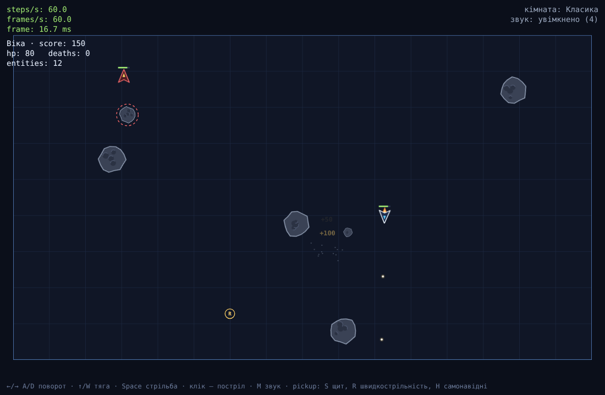
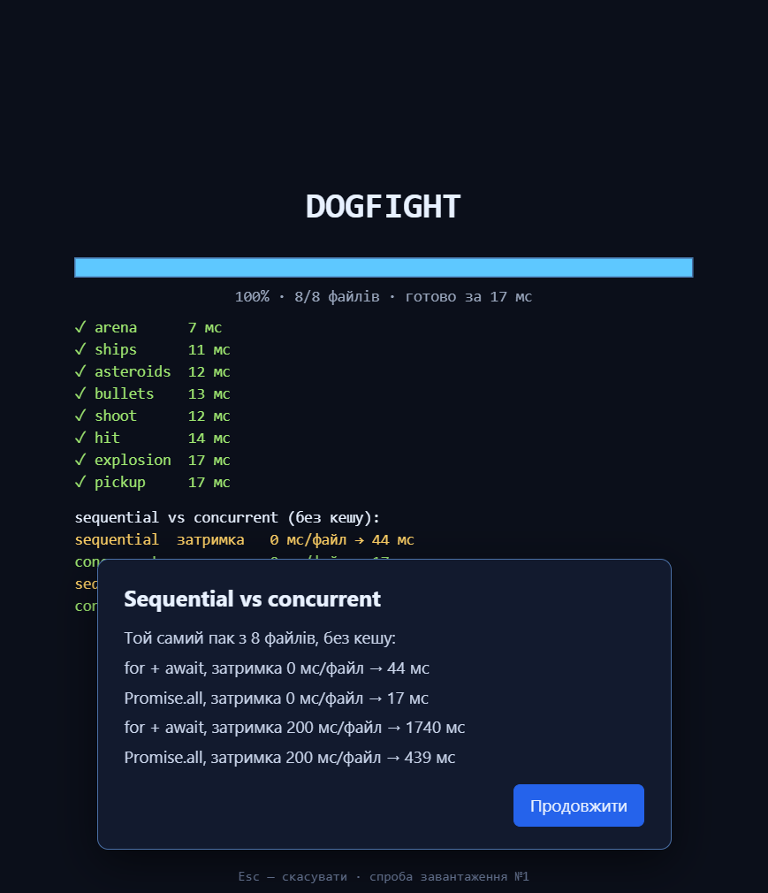
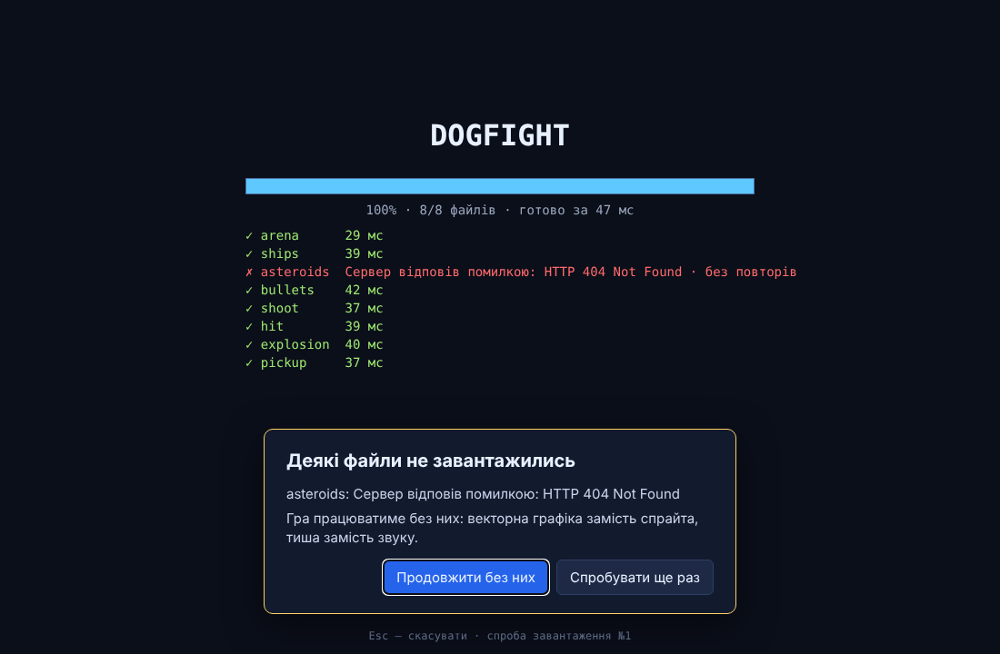
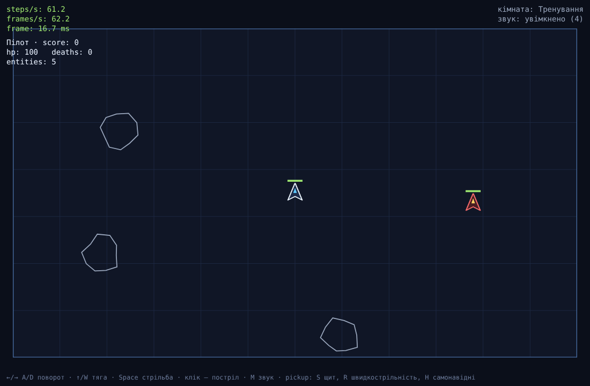
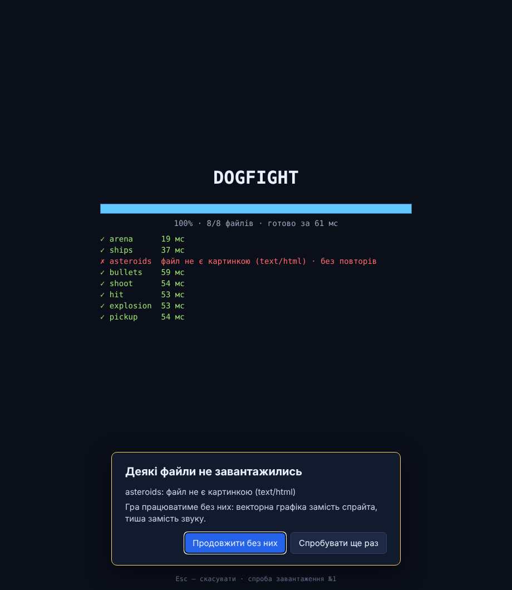
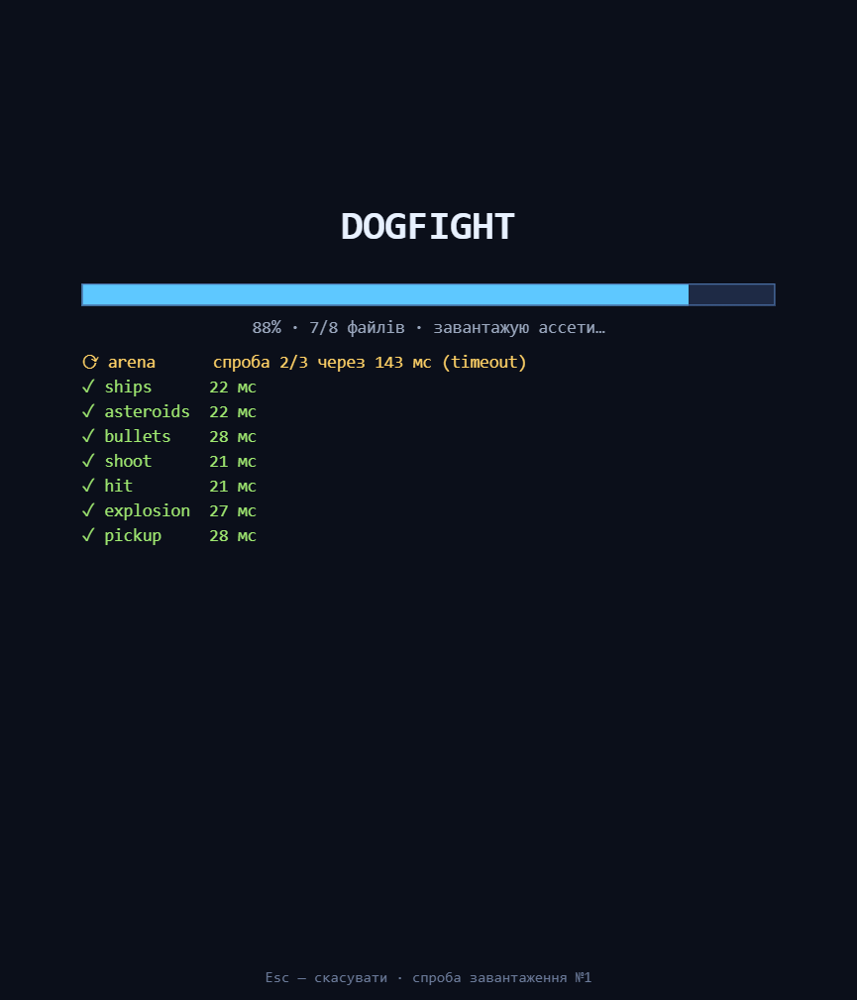
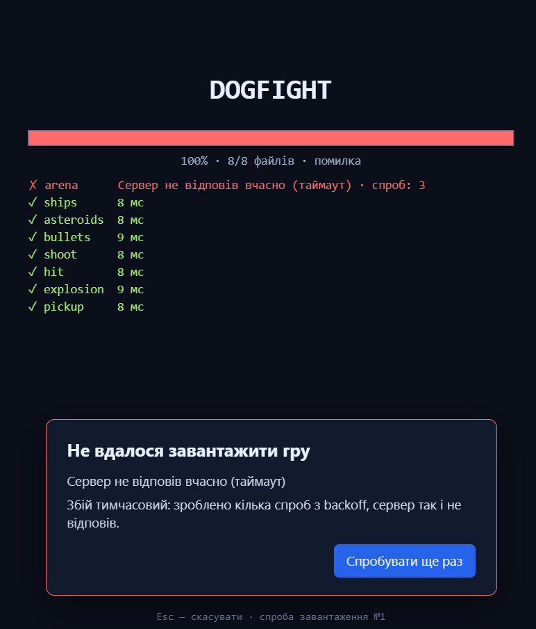
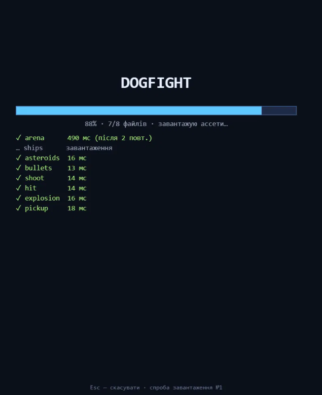
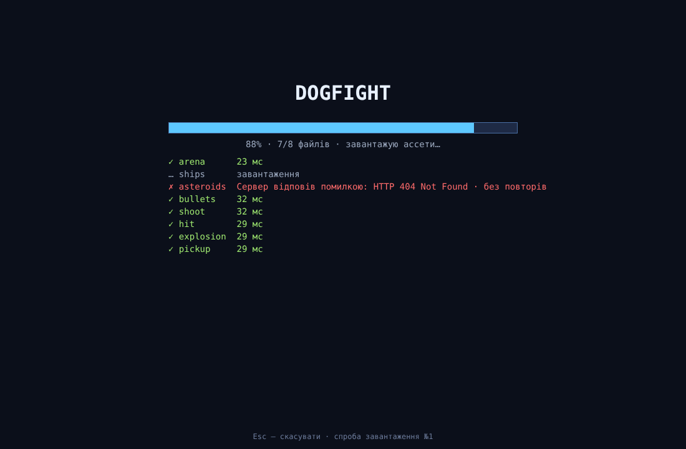
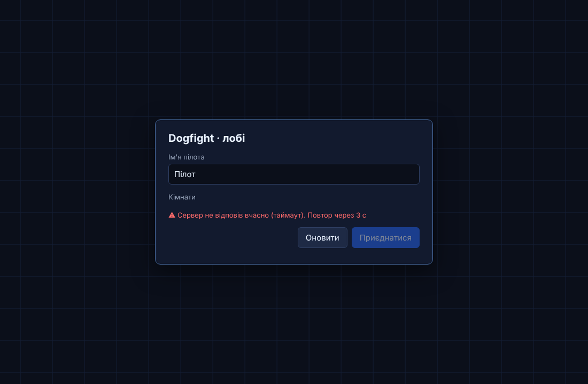

# Dogfight

Браузерна гра: космічний корабель на арені з «загортанням» країв, астероїди, кулі, pickup-и, звук, лобі.
Курс JavaScript, лаби 1–3 (мультиплеєр з'явиться в Lab 5).

**Шлях гравця:** екран завантаження → лобі (ім'я + кімната) → гра.
**Керування:** ←/→ або A/D поворот, ↑ або W тяга, **Space** стрільба (утримувати), **клік мишею** один постріл, **M** звук, **Esc** на екрані завантаження скасовує його.
**Pickup-и:** **S** щит (6 с без шкоди), **R** швидкострільність (8 с), **H** самонавідні кулі (8 с).
Червоний корабель — навчальний дрон-мішень. Астероїди в червоному пунктирному кільці — «мисливці», що летять на кораблі.

## Як запустити

```bash
npm install
npm run dev     # гра: http://localhost:5173
npm test        # 33 тести: симуляція, завантаження, retry, лобі (Node, без браузера)
npm run lint    # Biome
```

Версія Node вказана в `.nvmrc`. `/api/rooms` і навмисні збої віддає dev-сервер Vite (`dev/dev-api.js`), тож потрібен саме `npm run dev` (або `npm run preview`), а не відкриття `index.html` з диска.

## Структура

```
index.html               canvas + #ui (панелі лобі й помилок), стилі
puzzles.html             п'ять головоломок порядку (Lab 3): /puzzles.html
vite.config.js           підключає dev-api як middleware
dev/dev-api.js           /api/rooms, ?delay, ?status, ?flaky, ?corrupt, ?html, справжній 404 (Lab 4 замінить)
public/assets/
  manifest.json          список ассетів: тип, url, кадри спрайтшита, critical
  arena.json             параметри арени (кольори, крок сітки, розмір за замовчуванням)
  sprites/*.png          спрайтшити: ships (4 кадри), asteroids (3), bullets (2)
  sounds/*.wav           shoot, hit, explosion, pickup
tools/gen_assets.py      як згенеровано спрайти й звуки (Pillow + numpy)
src/
  main.js                loading → лобі → гра; Retry; фікс this
  async.js               sleep(ms, signal), once(target, type) — подія → проміс
  assets/http.js         HttpError, fetchJson (перевіряє ok), withRetry (backoff + jitter), explainError
  assets/loader.js       loadJson / loadImage / loadAudio з AbortSignal, loadAll з прогресом
  assets/faults.js       ?fault=… для галереї збоїв, ?bench — sequential vs concurrent
  audio.js               Web Audio: AudioContext після кліку, слухає події симуляції
  lobby/lobby.js         class Lobby extends EventTarget: refresh, таймаут, abort, join
  lobby/lobby-view.js    DOM лобі (лише малює й передає кліки)
  ui/panel.js            панель з кнопками → проміс з вибором (Retry / Продовжити)
  loop.js                фіксований крок 1/60 с (Lab 1)
  input.js               клавіатура як замикання (Lab 1)
  render/canvas.js       canvas з урахуванням devicePixelRatio
  render/draw.js         малювання за kind: спрайти, а якщо не завантажились — вектор
  render/sprites.js      вирізання кадрів зі спрайтшита (drawImage з source rect)
  render/hud.js          HUD — підписник подій: «+очки», стрічка подій, спалах шкоди
  render/loading.js      екран завантаження: прогрес-бар, статус кожного файлу
  sim/                   симуляція без DOM (Lab 2) + шина подій World.events
test/sim.test.js         13 тестів симуляції (Lab 2)
test/async.test.js       20 тестів: fetch/retry/таймаут/abort/битий JSON, loadAll, лобі, події, dev-api
```

## Лаба 3: асинхронний JavaScript

### Що зроблено

| Етап | Що | Де |
|---|---|---|
| M1 | `manifest.json` → `loadAll` через `Promise.all` з прогресом по кожному файлу; справжній прогрес-бар; гра стартує лише після `await loadAll(...)` | `assets/loader.js`, `render/loading.js`, `main.js` |
| M1 | `loadImage` / `loadAudio` / `loadJson` приймають `AbortSignal`; спільний `fetchChecked`/`fetchJson` перевіряє `res.ok`; `withRetry` з exponential backoff + jitter, без повторів на 4xx | `assets/http.js`, `assets/loader.js` |
| M2 | Кораблі, кулі, астероїди малюються зі спрайтшитів (`drawImage` з source rect); якщо спрайт не завантажився — векторна заміна з Lab 2 | `render/sprites.js`, `render/draw.js` |
| M2 | Web Audio: звуки декодуються на екрані завантаження, `AudioContext` створюється в обробнику кліку «Приєднатися» | `audio.js` |
| M2 | Шина `EventTarget` + `CustomEvent`: симуляція шле `fired`, `hit`, `exploded`, `scored`, `picked`; звук і HUD підписуються. Симуляція не імпортує ні звук, ні HUD (це перевіряє тест) | `sim/world.js`, `audio.js`, `render/hud.js` |
| M3 | Лобі: `class Lobby extends EventTarget`, `GET /api/rooms` кожні 3 с, `AbortSignal.timeout(2500)` на кожен запит, `abort()` при виході; DOM — окремий модуль | `lobby/lobby.js`, `lobby/lobby-view.js` |
| M4 | 5 власних головоломок порядку, галерея збоїв | нижче |




### Демонстраційні режими (параметри адреси)

| Адреса | Що видно |
|---|---|
| `/` | звичайний шлях: завантаження → лобі → гра зі звуком |
| `/?fault=404,slow` | `asteroids` → 404 одразу, `ships` їде 3 с: видно прогрес-бар посеред завантаження |
| `/?fault=404` | панель «Деякі файли не завантажились» → «Продовжити без них» → астероїди векторні |
| `/?fault=html` | сервер відповів **200**, але замість PNG прислав HTML-сторінку → «файл не є картинкою» → векторна заміна |
| `/?fault=timeout` | `arena.json` не відповідає: 3 спроби по 2 с з backoff → кнопка «Спробувати ще раз» → успіх |
| `/?fault=badjson` | битий `arena.json`: без повторів → кнопка Retry |
| `/?fault=abort` | усі файли повільні, через 0.8 с `abort()` → «Завантаження скасовано» → Retry |
| `/?fault=slow` + **Esc** | ручне скасування посеред завантаження |
| `/?fault=flaky,slow` | `arena.json` двічі віддає 503 → `✓ arena … (після 2 повт.)`; у консолі — затримки backoff |
| `/?bench` | вимір sequential vs concurrent прямо в грі |
| `/?lobby=slow` | лобі: сервер довше за таймаут → «Сервер не відповів вчасно», наступна спроба за 3 с |
| `/?lobby=down` / `/?lobby=badjson` | лобі: 503 / битий JSON — лобі живе, пробує знову |
| `/?lobby=lag` | кімнати їдуть 1.5 с; натиснути «Приєднатися», поки статус «Оновлюю…» → у консолі `[lobby] запит скасовано: гравець пішов з лобі` |
| `/?bug` | баг `this` з Lab 2 |
| `/puzzles.html` | п'ять головоломок порядку з кнопкою «Запустити» |

Збій діє лише на першу спробу завантаження: після «Спробувати ще раз» усе проходить нормально, так видно відновлення після помилки.

### Sequential vs concurrent

Той самий пак з 8 файлів (`arena.json`, 3 спрайтшити, 4 звуки), без кешу (`cache: "no-store"`), `?bench`:

| Спосіб | Без затримки | Затримка 200 мс на файл |
|---|---|---|
| `for (...) await load(item)` — sequential | 69 мс | **1731 мс** |
| `await Promise.all(items.map(load))` — concurrent | 21 мс | **439 мс** |

- **Sequential: 1731 мс ≈ 8 × 200 мс.** Кожен наступний запит стартує лише після попереднього: `const a = await loadA(); const b = await loadB()` — це черга, хоча файли одне від одного не залежать.
- **Concurrent: 439 мс ≈ 2 × 200 мс, а не 1 × 200 мс.** Усі 8 запитів стартують одразу, але браузер тримає не більше **6 з'єднань на один хост** для HTTP/1.1 (dev-сервер Vite). Тому 6 файлів їдуть першою «хвилею», 2 — другою. Виграш майже в 4 рази.
- Без штучної затримки локальний сервер відповідає за мілісекунди, і різниця мала. На справжній мережі кожен запит коштує десятки–сотні мілісекунд — саме тоді послідовні `await` і роблять завантаження довгим.



### Retry, таймаути, скасування

| Ситуація | Що робить `withRetry` | Чому |
|---|---|---|
| обрив мережі (`TypeError`), таймаут (`TimeoutError`), 5xx | повторює: 3 спроби, затримка `2^n · 250 мс`, з неї випадково ½…1 (jitter) | збій тимчасовий; jitter — щоб багато клієнтів не повернулися в одну мить |
| 4xx (наприклад, 404) | **не повторює** | файлу немає — і через секунду не з'явиться |
| битий JSON (`SyntaxError`), не картинка | не повторює | повтор поверне той самий зіпсований файл |
| 200 OK, але прийшов HTML замість PNG | не повторює | сервер «успішно» віддав не той файл — повтор отримає те саме |
| `abort()` (Esc, вихід з лобі) | не повторює, пауза між спробами теж переривається | гравець сам скасував |

- **Таймаут кожного запиту** — `AbortSignal.any([signal, AbortSignal.timeout(ms)])`: запит падає або від скасування ззовні, або від вичерпаного часу.
- **`fetch` не відхиляє проміс на 404.** Він виконується, щойно прийшли заголовки (`res.ok === false`). Тому `fetchChecked` сам кидає `HttpError` з номером статусу, а тіло читається окремим `await res.json()` — другим кроком, де теж може бути збій (битий JSON).
- **`Promise.all` нічого не скасовує.** Коли падає критичний `arena.json`, `loadAll` сам викликає `abort()` для решти файлів (`internal` контролер), і вони позначаються як «Скасовано».
- **Пастка Vite: SPA fallback.** На першому запуску `?fault=404` показав не «HTTP 404», а «файл не є картинкою (text/html)». Dev-сервер Vite на будь-яку невідому адресу віддає `index.html` зі статусом **200**, тож перевірка `res.ok` пройшла, і помилку зловило лише декодування картинки. Тому `dev/dev-api.js` тепер віддає справжній 404 для відсутніх файлів у `/assets/`, а випадок «200, але HTML» лишився окремим режимом `?fault=html`. Висновок: `res.ok` — необхідна, але не достатня перевірка, вміст теж треба валідувати.
- **Критичні й некритичні файли.** `arena.json` має `"critical": true` — без нього гри немає, пак відхиляється → Retry. Спрайти й звуки некритичні: збій потрапляє у `failures`, гра стартує з векторною графікою або без звуку.

### Шина подій: симуляція не знає про звук і HUD

```js
// sim/world.js — симуляція лише повідомляє
this.events = new EventTarget();
emit(type, detail) { this.events.dispatchEvent(new CustomEvent(type, { detail })); }

// audio.js — підписник
events.addEventListener("fired", (e) => { if (e.detail.ownerId === playerId) play("shoot"); });
```

| Подія | Хто шле | Хто слухає |
|---|---|---|
| `fired` | `Ship.fire()` | звук пострілу |
| `hit` | `Ship.takeDamage`, `Asteroid.takeDamage` | звук влучання; HUD — червоний спалах, якщо влучили в гравця |
| `exploded` | вибух корабля / астероїда | звук вибуху; HUD — стрічка «Дрона збито» / «Вас збито» |
| `scored` | `World.addScore` | HUD — «+50» над місцем влучання |
| `picked` | підбір pickup-у | звук pickup; HUD — «Підібрано: Щит» |

Тест «Симуляція не імпортує звук, HUD чи DOM» читає всі файли `src/sim/` і перевіряє, що вони імпортують лише сусідів з `src/sim/` і не звертаються до `document`/`window`. У Lab 5 на ці ж події підпишеться мережа.

**Звук.** `loadAudio` робить `fetch → arrayBuffer → decodeAudioData` ще на екрані завантаження (декодує `OfflineAudioContext`, який не грає звук і тому не потребує кліку). Справжній `AudioContext` створюється в обробнику кліку «Приєднатися» — це жест гравця, тож браузер дозволяє звук. Кожен постріл — новий дешевий `AudioBufferSourceNode` над тим самим декодованим буфером, тому звуки накладаються без затримки.

### Лобі

- `Lobby extends EventTarget` не знає про DOM: шле `loading`, `rooms`, `error`, `aborted`, `join`. `lobby-view.js` лише слухає ці події й малює, а кліки передає в `lobby.refresh()` / `lobby.join()`.
- `refresh()` повторюється кожні 3 с ланцюжком `setTimeout` (наступний запит — лише після завершення попереднього, без накладання), поки лобі відкрите і вкладка видима (`visibilitychange`).
- Кожен запит має `AbortSignal.timeout(2500)`. Збій лобі (таймаут, 503, битий JSON) не валить його: показується повідомлення, наступна спроба — за інтервалом.
- `join()` викликає `stop()` → `abort()`: запит, що летить, скасовується, і відповідь, яка прийде пізніше, вже не перемалює неіснуючий екран (у тесті сервер відповідає через 300 мс після виходу, а подія `rooms` так і не приходить).
- `/api/rooms` віддає `dev/dev-api.js` (Vite middleware): 5 кімнат з різними аренами, кількість гравців змінюється кожні 4 с, «Турнір» заповнений і недоступний. «Приєднатися» запускає локальну гру з `room.arena`: розмір арени, кількість астероїдів, частка «мисливців», seed.

### П'ять головоломок порядку

Кожну головоломку я запускала кілька разів на сторінці `http://localhost:5173/puzzles.html` (Edge), вивід щоразу однаковий.

**1. `await` віддає чергу навіть для не-промісу**

```js
log("A");
async function load() { log("B"); await null; log("C"); return "D"; }
load().then((v) => log(v));
Promise.resolve().then(() => log("E"));
log("F");
```

Вивід: `A, B, F, C, E, D`. Синхронно — A, B (до `await`), F. Продовження після `await` стало в чергу мікрозадач **раніше** за E, тож C, потім E; `return "D"` виконує проміс функції, і його `.then` стає в чергу лише тепер — D останнім.

**2. `setTimeout` всередині `.then`**

```js
setTimeout(() => log("T1"), 0);
Promise.resolve().then(() => {
  log("P1");
  setTimeout(() => log("T2"), 0);
  Promise.resolve().then(() => log("P2"));
});
log("S");
```

Вивід: `S, P1, P2, T1, T2`. Мікрозадачі виконуються всі, включно з новими (P2), до першого таймера; T2 поставлено в чергу задач після T1, тож і виконується після нього.

**3. `requestAnimationFrame`, мікрозадачі й таймер**

```js
requestAnimationFrame(() => {
  log("raf A");
  Promise.resolve().then(() => log("micro after A"));
  setTimeout(() => log("timeout from A"), 0);
});
requestAnimationFrame(() => log("raf B"));
Promise.resolve().then(() => log("micro"));
log("sync");
```

Вивід: `sync, micro, raf A, micro after A, raf B, timeout from A`. rAF — не задача й не мікрозадача, а крок рендерингу; черга мікрозадач спустошується **після кожного** rAF-колбека (тому «micro after A» перед «raf B»), а таймер з rAF чекає, поки завершаться всі rAF-колбеки цього кадру.

**4. Колбек із кешу vs проміс — чому `loadImage` повертає проміс**

```js
let ready = false;
loadCb("ship.png", () => log(`callback: ready=${ready}`)); // з кешу — викликає одразу
loadP("ship.png").then(() => log(`promise: ready=${ready}`));
ready = true;
```

Вивід: `callback: ready=false, promise: ready=true`. Колбек з кешу спрацював синхронно, ще до `ready = true`, а з мережі спрацював би пізніше — один код, два порядки. Проміс завжди викликає `.then` асинхронно, тому порядок однаковий і для кешу, і для мережі.

**5. `Promise.all` падає першим, але сусіди добігають**

```js
Promise.all([wait(20, "ships"), Promise.reject(new Error("arena")), wait(10, "sounds")])
  .then(() => log("all ok"))
  .catch((e) => log(`caught ${e.message}`))
  .finally(() => log("finally"));
log("started");
```

Вивід: `started, caught arena, finally, done sounds, done ships`. `Promise.all` відхиляється на першому reject, не чекаючи решти, але решта таймерів не скасовується і добігає. Тому в `loadAll` «сусідів» зупиняємо самі через `AbortController`.

### Галерея збоїв

Жоден збій не валить гру: вона або стартує із заміною, або показує зрозуміле повідомлення й кнопку «Спробувати ще раз».

| Збій | Як відтворити | Що бачить гравець | Повтори |
|---|---|---|---|
| **404 спрайта** | `?fault=404` | панель «Деякі файли не завантажились: asteroids — HTTP 404» → «Продовжити без них» → астероїди векторні | немає (4xx) |
| **200, але HTML замість картинки** | `?fault=html` | `✗ asteroids файл не є картинкою (text/html)` → «Продовжити без них» → векторна заміна | немає |
| **Таймаут мережі** | `?fault=timeout` | `✗ arena Сервер не відповів вчасно · спроб: 3` → «Не вдалося завантажити гру» → Retry → успіх | 3 спроби, ~7 с |
| **Abort посеред завантаження** | `?fault=abort` або Esc | усі файли «Скасовано» → «Завантаження скасовано» → Retry | немає |
| **Битий JSON** | `?fault=badjson` | `✗ arena Битий JSON: Unexpected end of JSON input`, решта «Скасовано» → Retry | немає |
| **Тимчасовий 503** | `?fault=flaky,slow` | `✓ arena … (після 2 повт.)` — гравець збою майже не помітив | 2 повтори |
| **Лобі: таймаут** | `?lobby=slow` | «⚠ Сервер не відповів вчасно (таймаут). Повтор через 3 с» | кожні 3 с |

| 404 спрайта | 404 → гра з векторною заміною |
|---|---|
|  |  |

| 200, але HTML замість картинки | Таймаут: повтор з backoff (спроба 2/3) |
|---|---|
|  |  |

| Таймаут: 3 спроби вичерпано → Retry | Abort |
|---|---|
|  |  |

| Битий JSON | 503 → retry → успіх |
|---|---|
|  |  |

| Прогрес посеред завантаження (404 + повільний файл) | Лобі: таймаут |
|---|---|
|  |  |

### Досліди з нотаток

| Дослід | Результат | Пояснення |
|---|---|---|
| §1 `resolve(1); resolve(2)` | лише `1` | проміс встановлюється один раз, другий `resolve` ігнорується |
| §1 `Promise.resolve("ready").then(...)`; `log("after subscribe")` | `after subscribe`, потім `then ready` | `.then` завжди асинхронний, навіть для готового промісу |
| §2 `setTimeout(1)`, `.then(2).then(3)`, `async { 4; await 0; 5 }`, `6` | `4, 6, 2, 5, 3, 1` | 4 і 6 синхронно; 2 уже в черзі, 5 стає за ним; 3 — лише коли виконався 2; 1 — задача після всіх мікрозадач |
| §3 забутий `return` у `.then` | `forgot undefined`, `returned 2` | ланцюг чекає на те, що повернули; без `return` далі їде `undefined` |
| §3 `throw` у `.then` → `.then(b)` → `.catch` → `.then(d)` | `a 1, c boom, d` (без `b`) | помилка їде вниз до `.catch`; після нього ланцюг знову fulfilled |
| §4 `fetch` на 404 / на неіснуючий хост | `ok false status 404` / reject `TypeError` | 404 — сервер відповів (fulfill); reject — лише коли запиту не було |
| §5 два `await wait(1000)` vs `Promise.all` | ~2003 мс vs ~1001 мс | послідовні `await` стартують другу роботу лише після першої |
| §5 `Promise.all([slow, reject])` | одразу `all fast`, через 300 мс `slow still ran` | `all` нічого не скасовує |
| §6 `abort()` / `AbortSignal.timeout` | `AbortError` / `TimeoutError` | скасування — через сигнал, не через сам проміс |
| §6 необроблений reject у Node | процес завершується з кодом **1** | у браузері — лише подія `unhandledrejection` і повідомлення в консолі |
| §7 два `.then` на готовому промісі / пізній `addEventListener` | `early` і `late` / лише `heard 1` | проміс пам'ятає значення, подія — ні |

---

## Лаба 2: об'єкти, класи, this і композиція

### Що зроблено

- **Vector2** з чистими методами `add`, `sub`, `scale`, `length`, `normalize`, `rotate`, `dot`, `static fromAngle`.
  Вектори не мутуються, тому для інтерполяції достатньо зберегти посилання: `prevPos = pos`.
- **Entity**: приватний статичний лічильник `static #nextId` і `#id` з публічним `get id()`.
  Наслідування рівно на **один рівень**: `Ship`, `Bullet`, `Asteroid`, `Pickup`, `Explosion` extends `Entity`.
- **World** зберігає сутності в `Map<id, Entity>`:
  - `spawn` під час кроку кладе сутність у чергу й додає після кроку;
  - `despawn` лише ставить `alive = false`, а видаляє `#sweep` наприкінці `step`;
  - `[Symbol.iterator]` дає `for (const e of world)`, генератор `*ofKind(kind)` фільтрує без проміжного масиву.
- **World.step(dt, inputs)**: зберегти попередній стан → системи (spawner, homing) → `update` усіх → пари колізій → правила → `#sweep`.
- **Колізії** — окрема функція-генератор `circleCollisions(world)`, яку передано в `World` параметром `detect`.
  Її можна замінити на spatial hash, не чіпаючи правил. Відстань рахується з урахуванням загортання країв.
- **Корабель**:
  - приватне `#hp` і `get hp()` (присвоєння `ship.hp = 1000` кидає `TypeError`);
  - приватний метод `#explode`;
  - вибух із частинок і респаун через 2 с у безпечній точці з 1.5 с невразливості;
  - очки на HUD: астероїди 20/50/100, дрон 100.
- **Кулі** вилітають з носа корабля з успадкованою швидкістю, живуть 1.1 с.
- **Астероїди** дрейфують, відскакують один від одного, великі розколюються на два менші.
- **Детермінізм**: замість `Math.random` у симуляції — генератор із seed. Тест перевіряє, що два запуски по 20 с дають однаковий світ (знадобиться в Lab 5).


### Баг з this у колбеку та його фікс

`fire()` — звичайний метод класу, тому його `this` визначається **в момент виклику**, а не тим, «чий це метод».

Наївне підключення (його можна відтворити, відкривши `http://localhost:5173/?bug` і натиснувши будь-яку клавішу):

```js
window.addEventListener("keydown", player.fire); // передали функцію, а не виклик
```

У консолі з'являється:

```
TypeError: Cannot read properties of undefined (reading 'add')
```

**Чому.** `addEventListener` отримав лише функцію, без об'єкта зліва від крапки. Браузер викликає колбек з `this === window` (неявна прив'язка до цілі події). У `window` немає поля `pos`, тому `this.pos.add(...)` падає. Якщо викликати таку функцію просто як `f()`, вийде `this === undefined`, бо модулі й класи завжди працюють у strict mode.

**Обраний фікс** (`main.js`): стрілка-обгортка.

```js
canvas.addEventListener("pointerdown", () => player.fire());
```

Всередині стрілки йде звичайний виклик `player.fire()`: зліва від крапки стоїть `player`, тому `this === player`.
Обрано цей варіант, бо він найочевидніший при читанні і не змінює клас.

**Альтернативи:**

| Варіант | Як | Мінус |
|---|---|---|
| Стрілка-обгортка | `() => player.fire()` | нову функцію не можна передати в `removeEventListener` без збереження у змінну |
| `bind` | `player.fire.bind(player)` | щоразу нова функція; для зняття слухача теж треба зберігати посилання |
| Поле-стрілка в класі | `fire = () => { … }` | окрема копія функції в **кожному** екземплярі замість однієї на прототипі; не працює `super.fire()` у нащадку |

Стрілка не має власного `this` і бере його з місця, де її створено, тому `bind`/`call` на неї не діють.

Основна стрільба (Space) не проходить через колбеки взагалі: `Ship.update` перевіряє `input.isDown("Space")` всередині кроку симуляції. Так постріли детерміновані й прив'язані до фіксованого кроку.


### Композиція замість глибокої ієрархії (дизайн-запис)

**Як виглядала б ієрархія.** Спокусливо почати так:

```
Entity
├─ MovingEntity
│  ├─ Ship → PlayerShip
│  ├─ Bullet → HomingBullet
│  └─ Asteroid → HomingAsteroid
└─ StaticEntity
   └─ Pickup → ShieldPickup, RapidPickup, HomingPickup
```

Проблеми з'являються одразу:
- `HomingBullet` і `HomingAsteroid` мають **однаковий** код наведення, але лежать у різних гілках. Доведеться або дублювати його, або піднімати в `MovingEntity`, і тоді наведення «отримають» усі, кому воно не потрібне.
- Pickup «homing» має перетворювати **звичайну** кулю на самонавідну. У дереві класів тип об'єкта не змінити після створення, тож для цього знадобився б окремий клас кулі, а потім `HomingRapidBullet` і так далі. Кількість класів росте як добуток фіч.
- Стаціонарна турель, що стріляє, або корабель, який може підібрати pickup, не вписуються в жодну гілку.

**Що зроблено замість цього.** Наслідування лише на один рівень (`X extends Entity`) для спільного: id, позиція, рух. Решта — **компоненти як поля-дані** і **системи**, які шукають поле, а не клас:

| Компонент | Де висить | Хто обробляє |
|---|---|---|
| `homing: { targets, turnRate, range, ignoreId }` | на `Bullet` **або** `Asteroid` | `homingSystem` |
| `pickup: { type, duration, label, color }` | на `Pickup` | `rules.js` |
| `effects: Map<тип, секунд>` | на `Ship` | `rules.js`, `Ship.fire()` |

- Самонавідна куля — це звичайний `Bullet`, якому `fire()` передав `homing`, якщо в корабля активний ефект `homing`.
- Астероїд-«мисливець» — звичайний `Asteroid` з тим самим компонентом, тільки `targets: ["ship"]`. Система однакова для обох; тест «одна система для кулі й астероїда» це перевіряє.
- Pickup підбирає **будь-хто**, у кого є `effects`. Правило звучить як `if (a.pickup && b.effects)`, а не `if (b instanceof Ship)`.
- Поведінка задана даними: `PICKUP_TYPES`, `ASTEROID_SIZES`, `BULLET`, `TUNING`. Нова фіча — це новий рядок у таблиці або нове поле, а не новий клас.

**Чому саме компоненти-поля, а не міксини чи повний ECS.**
- Міксини через `Object.assign` змішують методи в один об'єкт, і стає незрозуміло, звідки береться метод.
- Повний ECS із масивами — надто багато інфраструктури для цієї лаби.

Компоненти-поля — це прості дані, які легко серіалізувати в JSON. Це знадобиться в Lab 5, коли стан світу треба буде передавати мережею.

### Досліди в консолі (notes §1–§3)

| Дослід | Результат | Пояснення |
|---|---|---|
| §1 `b = Object.create(a)`, `a.hello = 1` | `b.hello` → `1`, власного поля немає (`false`), прототип `b` — це `a` (`true`); після `a.hello = 2` → `2` | `b` не копіює `hello`, а шукає його вгору по прототипу. Так само тисяча куль ділить один `update` з `Bullet.prototype`. |
| §2 `const m = a.m; m()` | `undefined`; `m.call(a)` → `A {}` | голий виклик у strict mode дає `this === undefined`; `call` прив'язує явно |
| §3 `o[1]`, `o["1"]`, `m.get(1)`, `m.get("1")` | `x`, `x`, `x`, `undefined`; ключі об'єкта `["1", "[object Object]"]` | у звичайному об'єкті ключі стають рядками, у `Map` число `1` і рядок `"1"` — різні ключі |
| два ланцюги `extends` | `getPrototypeOf(B.prototype) === A.prototype` → `true`, `getPrototypeOf(B) === A` → `true` | екземпляри: `b → B.prototype → A.prototype`; статика: `B → A` |

У грі (`npm run dev`) об'єкти доступні в консолі як `game.player` і `game.world`.
Наприклад:
- `Object.getPrototypeOf(Object.getPrototypeOf(game.player)).constructor.name` → `"Entity"` (ланцюжок `player → Ship.prototype → Entity.prototype`);
- `Object.hasOwn(game.player, "fire")` → `false` (метод живе на прототипі, а не в об'єкті);
- `[...game.world.ofKind("asteroid")]` — усі астероїди.

**Чому Map, а не `{}` для світу:**
- ключі-числа лишаються числами;
- є справжній `.size`;
- порядок вставки гарантовано;
- немає успадкованих ключів на кшталт `constructor`;
- швидше працює при частому додаванні й видаленні.

---

## Лаба 1: event loop і ігровий цикл

### Тюнінг

| Параметр | Було | Стало | Чому |
|---|---|---|---|
| drag | 0.6 | 0.8 | Спочатку пробувала 0.2: з максимальної швидкості корабель гальмує до 10 % за ~11.5 с і пролітає кілька кіл арени, точно керувати неможливо. При 0.6 це ~3.8 с, корабель все ще «пливе» після відпускання тяги. При 0.8 це ~2.9 с: гальмування помітне, але плавне. |
| thrust | 450 | 550 | Після збільшення drag корабель став розганятися повільніше: з thrust 450 і drag 0.8 розгін до maxSpeed (450 px/с) займав ~2 с, це відчувалося «ватно». З 550 розгін займає ~1.3 с, тобто навіть трохи швидше, ніж у початковому варіанті (~1.5 с). |
| turnSpeed | 3.5 | 4.2 | Розворот на 180° (π рад) при 3.5 рад/с займав ~0.9 с, і корабель не встигав розвернутися перед краєм арени. При 4.2 рад/с це ~0.75 с: корабель маневрує швидше, але ще не «смикається» при короткому натисканні. |

Фінальні значення: turnSpeed = 4.2, thrust = 550, drag = 0.8, maxSpeed = 450.

### Вимірювання

Монітор: 60 Гц. steps/s = 60, frames/s = 60 (frame ≈ 16.7 мс).
При низькому заряді батареї (режим енергозбереження) frames/s впало до 30,
але steps/s лишалося 60: акумулятор виконував по 2 кроки фізики за кадр.
Це показує, що симуляція не залежить від частоти кадрів.

### Експеримент 1: блокуючий цикл у render

**Що зробила:** кожен 60-й кадр у render додала busy-wait на 100 мс.

**Результат:**
- frame: раз на секунду пік ~100 мс, інакше 16.7 мс
- frames/s: 60 → 55.4
- steps/s: лишилося 60.0

**Що бачить гравець:** раз на секунду корабель підстрибує/завмирає на мить.

**Пояснення через event loop:** JavaScript виконується в одному потоці.
Поки виконується мій цикл while, стек викликів зайнятий, і event loop
не може взяти наступне завдання: ні rAF-колбек, ні подію клавіатури,
ні таймер. Браузер не може намалювати кадр, бо рендеринг теж чекає на
порожній стек. Тому 100 мс блокування не можна «обійти» всередині того
самого потоку: єдине рішення це не блокувати (розбити роботу на частини
або винести у Web Worker). Steps/s не впали, бо після блокування
накопичений час за один кадр віддається фізиці кількома кроками по 1/60 с.


### Експеримент 2: setInterval замість requestAnimationFrame

**Що зробила:** у loop.js замінила rAF на setInterval з інтервалом 16 мс.

**Результат (10 с спостережень):**
- frames/s: 60.0 (rAF) → 62.2 (setInterval)
- frame: стабільні 16.5–16.7 мс → коливання 15–20 мс
- steps/s: 60.0 → 60.2

**Фонова вкладка (5 с), HUD одразу після повернення:**

| Цикл | steps/s | frames/s | frame |
|---|---|---|---|
| rAF | 31.5 | 24.5 | 16.6 мс |
| setInterval (1-й скріншот) | 60.8 | 62.7 | 16.5 мс |
| setInterval (2-й скріншот) | 60.0 | 62.0 | 16.5 мс |

- **rAF:** у прихованій вкладці браузер взагалі не викликає rAF, тому гра
  стоїть на паузі й не витрачає процесор і батарею. Після повернення HUD на
  секунду просідає (31.5 / 24.5), бо вікно підрахунку охоплює паузу, у якій
  не було ні кадрів, ні кроків. Перший кадр бачить проміжок ~5 с, але
  обмеження `Math.min(..., 0.25)` обрізає його до 0.25 с (15 кроків замість
  300), тому корабель не «телепортується». Сам кадр уже нормальний: 16.6 мс.
- **setInterval:** HUD після повернення майже не змінився (60.8 / 62.7), бо
  цикл **не зупинявся** у фоні: браузер лише сповільнює таймери прихованих
  вкладок (зазвичай до 1 виклику на секунду), і лічильники HUD продовжували
  оновлюватися. Тобто гра витрачала ресурси, хоча її ніхто не бачив.


**Невдала перша спроба (теж показова):** під час першої спроби в кінці
`frame` лишився виклик `requestAnimationFrame(frame)`, а цикл запускав
setInterval. Кожен тик таймера створював ще один нескінченний ланцюжок rAF,
і HUD показав frames/s 5889 → 68708 → 89321 при frame 0.0 мс: усі ланцюжки
виконувалися в тому самому кроці рендерингу. Steps/s при цьому піднялися до
~83, бо setInterval передає `performance.now()`, а rAF передає час початку
кадру, тож час «стрибав» назад і частина інтервалів рахувалася двічі.

**Пояснення:** setInterval ставить колбек у чергу завдань за таймером і не
знає про частоту оновлення екрана. 16 мс ≠ 16.67 мс, тому колбеки то
випереджають малювання, то запізнюються (і ще й чекають, поки стек
звільниться). requestAnimationFrame викликається браузером
рівно перед малюванням (крок рендерингу event loop), тому кадри рівномірні,
а у прихованій вкладці він призупиняється.


### Експеримент 3: змінний крок замість фіксованого

**Що зробила:** спочатку в loop.js прибрала акумулятор, і simulate(dt)
викликався один раз за кадр з dt = реальний час кадру. Для відтворюваності
корабель сам тримає тягу (підмінений input), а в консоль виводиться стан,
коли симуляційний час досягає 5 с. Щоб кадри були довгими, у render додано
busy-wait 30 мс. Також вмикала CPU throttling 6x slowdown у DevTools.
Потім повернула фіксований крок 1/60 с з акумулятором і повторила вимірювання
без навантаження і з навантаженням.

**Результати (стан корабля, коли t ≥ 5 с):**

| Режим | HUD (steps/s / frames/s / frame) | Результат |
|---|---|---|
| Змінний крок, без навантаження, запуск 1 | 60 / 60 / 16.7 мс | t=5.0008, y=245.172 |
| Змінний крок, без навантаження, запуск 2 | 60 / 60 / 16.8 мс | t=5.0083, y=241.844 |
| Змінний крок, без навантаження, запуск 3 | 60 / 60 / 16.6 мс | t=5.0001, y=245.515 |
| Змінний крок, навантаження 30 мс, запуск 1 | 30.0 / 30.0 / 33.4 мс | t=5.0332, y=228.934 |
| Змінний крок, навантаження 30 мс, запуск 2 | 30.0 / 30.0 / 33.3 мс | t=5.0165, y=236.465 |
| Змінний крок, навантаження 30 мс, запуск 3 | 29.5 / 29.5 / 33.2 мс | t=5.0166, y=236.291 |
| **Фіксований крок, без навантаження** | 60.0 / 60.0 / 16.7 мс | **t=5.0167, y=238.075** |
| **Фіксований крок, навантаження 30 мс, запуск 1** | 61.0 / 29.5 / 33.4 мс | **t=5.0167, y=238.075** |
| **Фіксований крок, навантаження 30 мс, запуск 2** | 60.0 / 29.0 / 33.2 мс | **t=5.0167, y=238.075** |

**Спостереження:**
- При змінному кроці `t` і `y` щоразу відрізняються, хоча дії однакові:
  `y` коливається від 228.9 до 245.5 (різниця ~16.6 px). Найбільше
  відхилення було при довгих кадрах (t=5.0332), бо симуляція «перестрибує»
  момент t = 5 с на великому кроці dt, і інтегрування дає інший результат.
- При змінному кроці `steps/s` дорівнює `frames/s` (30 і 30): кількість
  кроків фізики прив'язана до частоти кадрів.
- При фіксованому кроці `steps/s` лишається ≈ 60 навіть коли `frames/s`
  упав до ≈ 29: акумулятор виконує по 2 кроки за кадр.
- **Головне:** з фіксованим кроком результат однаковий з навантаженням і без
  нього (t=5.0167, y=238.075). Це рівно 301 крок по 1/60 с, незалежно від того,
  скільки кадрів намалював браузер.


**Висновок:** змінний крок робить симуляцію недетермінованою: результат
залежить від швидкодії комп'ютера, навантаження та моментів, коли
браузер видає кадри. Фіксований крок 1/60 с гарантує однакову послідовність
кроків при будь-якій частоті кадрів, тому однакові вхідні дані дають
однаковий результат. Це критично для мультиплеєра (Lab 5): клієнт і сервер
мають незалежно отримувати той самий стан. Крім того, при змінному кроці
довгий кадр (наприклад, зависання на 500 мс) дав би величезний dt і
«телепортував» би корабель крізь стіни; фіксований крок разом з обмеженням
`Math.min(..., 0.25)` цьому запобігає.
